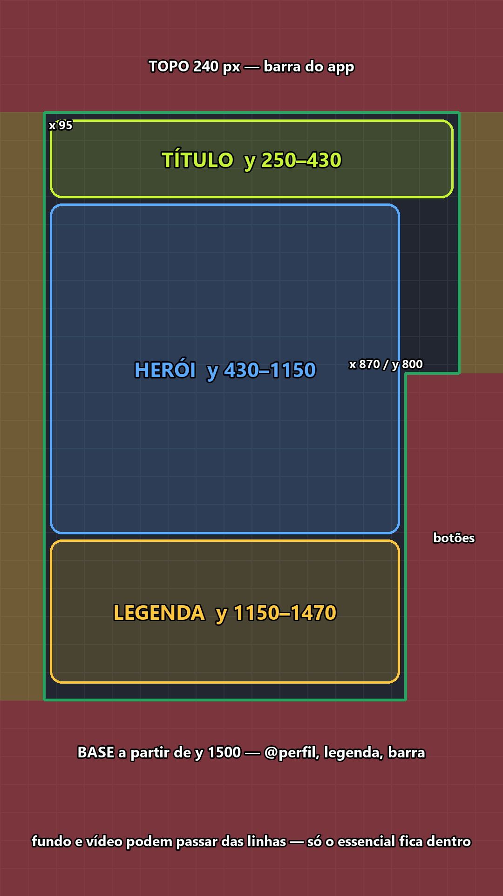

# Safe zone 9:16 — OBRIGATÓRIA antes de produzir qualquer visual vertical

Medida em prints reais do Instagram (aba Reels, perfil e feed) em out/2026. Vale também pra TikTok e Shorts.
Canvas 1080×1920 (escalar proporcionalmente em outras resoluções).

## As medidas
| Zona | Onde | O que tem lá |
|---|---|---|
| Topo | y 0–240 | "Reels \| Amigos", status do celular |
| Base | y 1500–1920 | @perfil, legenda do post, música, barra do app |
| Laterais | x 0–95 e x 985–1080 | corte em celulares altos |
| Botões | x 870–1080, de y 800 até 1500 | curtir, comentar, compartilhar, salvar |

**Área segura:** x 95–985 entre y 240 e 800; x 95–870 entre y 800 e 1500. Centro horizontal seguro na metade de baixo: x ≈ 482.

## Regra de ouro: usar a área TODA
A safe zone não é pra encolher o vídeo. O fundo, o cenário, a moldura e o vídeo real podem (e devem) ocupar a tela inteira e passar das linhas. O que precisa ficar **inteiro dentro** da área segura é o **essencial**: títulos, legendas, números, logos, rótulos, selos, botões desenhados, o rosto/objeto que está sendo explicado e qualquer texto que a pessoa precise ler.

## Faixas recomendadas (não obrigatórias)
- **Título / lettering do topo:** y 250–430 (logo abaixo da barra do app).
- **Herói (o que está sendo explicado):** y 430–1150.
- **Legenda palavra a palavra:** y 1150–1470, largura até x 870 (centro x ≈ 482). Máx. 2 linhas.
- **Vídeo real em moldura:** pode ir de y ~440 até ~1490 com largura ~840.
- Não empilhar título + legenda + cartão grande na mesma região ao mesmo tempo.

## Capa
A grade do perfil corta a capa em 3:4: aparece só y 240–1680. Título da capa dentro disso, longe das bordas.

## Checklist (antes do render final)
1. Planejar as posições com estas medidas ANTES de animar (não usar medidas antigas: 300/1220/900 está obsoleto).
2. Medir a caixa total do elemento durante a animação inteira (entrada, overshoot, escala, câmera, callouts presos a objetos 3D) — não só a âncora. `python safe_zone.py caixa x0 y0 x1 y1` diz o que invade.
3. Gerar a folha de conferência: `python safe_zone.py checar video.mp4 --tempos 1,4,8,...` (sem `--tempos` pega 8 quadros espalhados). Incluir todos os planos, a legenda mais longa e o CTA.
4. Corrigir o que invadir e repetir. O master sai SEM o overlay (o overlay é só pra conferir).
5. Avisar o usuário que a conferência foi feita com o overlay (não é teste no app real).
